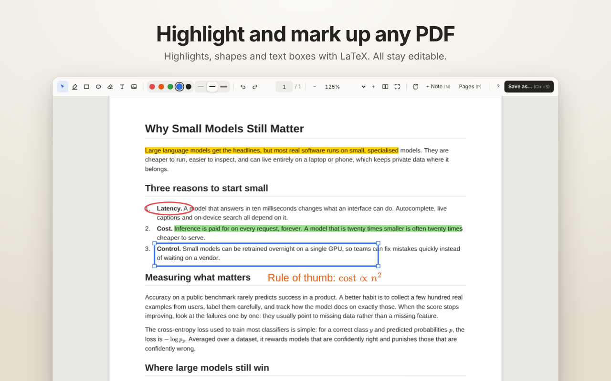
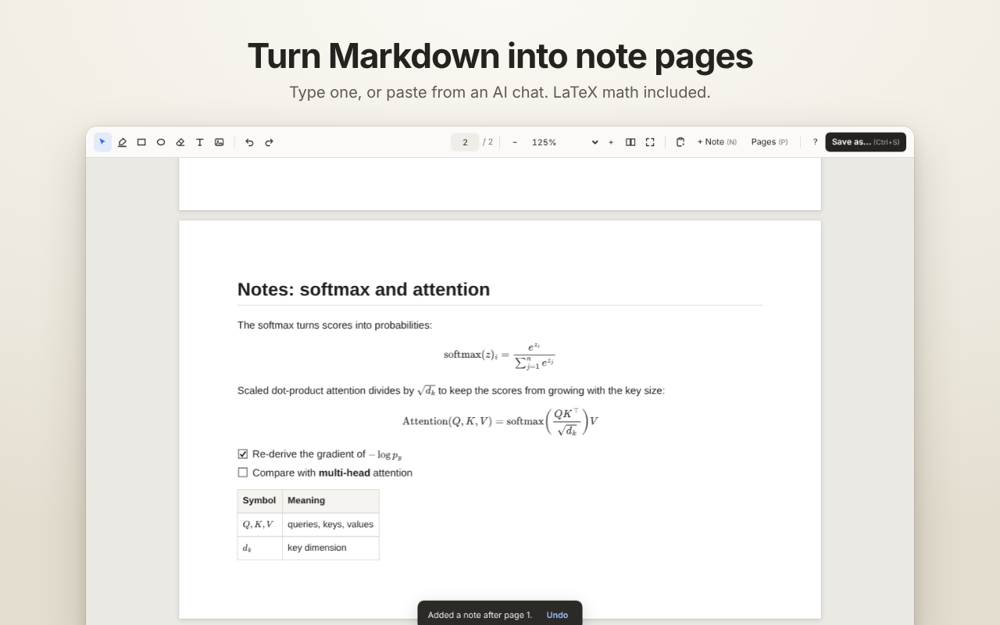
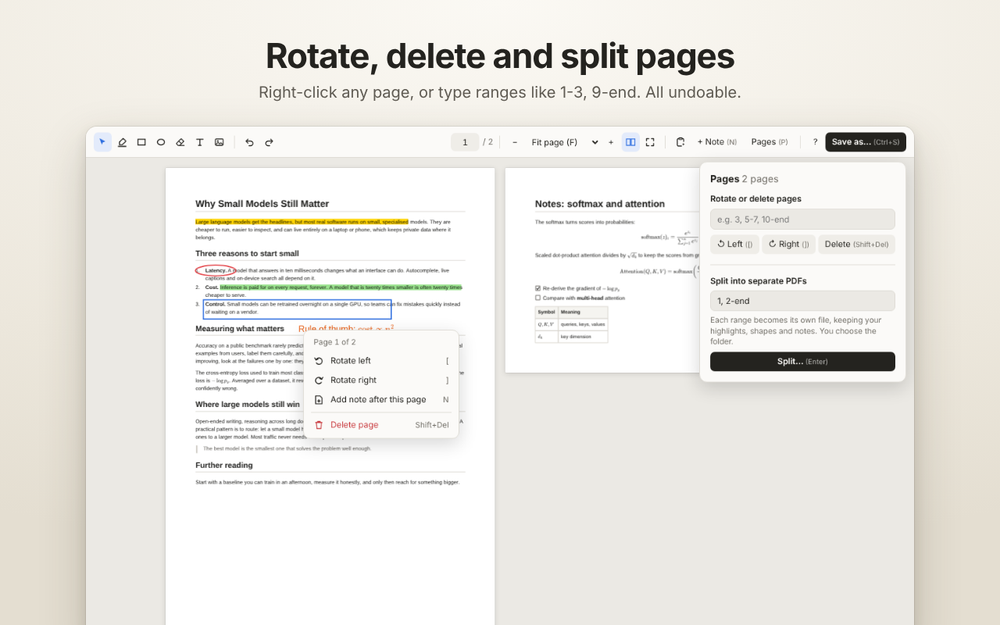

<p align="center">
  
</p>

<h1 align="center">Inkfold</h1>

<p align="center">
  Highlight, draw, add Markdown &amp; LaTeX notes, and rotate, delete or split pages in any PDF, right in Chrome.<br>
  Lightweight, keyboard-first, and private: your files never leave your computer.
</p>

<p align="center">
  
</p>

## Features

- **Highlighter** that follows the lines of real text, in any colour.
- **Rectangles and ellipses** to mark up figures, tables or anything else. Move and resize them any time.
- **Text boxes** with **LaTeX**: press <kbd>T</kbd>, click and type. Put math between `$` signs (`$\frac{a}{b}$`) and it's typeset as you finish. Pick any colour and size; the font is Helvetica, so the box looks the same in every PDF viewer.
- **Markdown notes**: press <kbd>N</kbd>, then type a note or use the Markdown on your clipboard, and a new page with your formatted note appears after the current one. The page is as wide as the one before it and exactly as tall as the note. Headings, lists, checkboxes, tables, code, quotes and links all work.
- **LaTeX math** in notes: `$inline$`, `$$display$$`, `\(…\)`, `\[…\]` and `align`-style environments, drawn as sharp vector shapes.
- **Page tools**: right-click a page to rotate or delete it, or work on ranges like `2-4, 7, 10-end`, and **split** a PDF into several files in one go.
- **Fit width, fit page, two-page view and full screen**, with smooth resizing even on long documents. The toolbar shows the page you're on; type a number (or press <kbd>G</kbd>) to jump to any page.
- **Text recognition (OCR)** for scanned PDFs: pages without text are read automatically in the background, with a small progress bar (you can stop it). The text becomes selectable, searchable and highlightable, and saved copies contain it as invisible text, so they're searchable everywhere. Runs entirely on your computer with the bundled [Tesseract](https://github.com/tesseract-ocr/tesseract) engine; English text. PDFs that already have text are left alone.
- **Compression**: the first time you open a PDF that could be more than 20% smaller (usually because of oversized images), a small card offers to compress it. Copies you save are then smaller; nothing else changes.
- **Selectable, searchable text** (Ctrl+F works), readable by screen readers and by assistants such as Gemini in Chrome. PDFs open in their own tab with their normal `https://` or `file://` address, so you can share them with Gemini in Chrome's side panel.
- **Standard PDF annotations**: everything you add shows up in Acrobat, Preview, Chrome's own viewer and others, and stays editable when you reopen the file in Inkfold.
- **Magic paste** (<kbd>Ctrl</kbd>+<kbd>V</kbd>, or the clipboard button): Inkfold looks at what you copied and offers the right thing: a picture goes onto the current page, Markdown becomes a note page after it, and plain text becomes a text box on it.
- **Images** (<kbd>I</kbd>): paste a picture from the clipboard or upload one from your computer. It's placed on the page, scaled to fit, and can be moved, resized (keeping its proportions) and deleted like any other annotation.
- **Eraser** (<kbd>E</kbd>): click or drag across highlights, shapes and text boxes to remove them.
- **Undo and redo** for everything, including page changes.
- **A keyboard shortcut for every action**, shown in brackets on every button. Press <kbd>?</kbd> for the full list.

<p align="center">
  
  &nbsp;
  
</p>

## Install

### From a release

Download `inkfold-<version>.zip` from [Releases](https://github.com/MeetCoding/inkfold/releases), unzip it, open `chrome://extensions`, turn on **Developer mode**, click **Load unpacked** and choose the unzipped folder.

### From source

1. Download this repository (green **Code** button → **Download ZIP**) and unzip it, or `git clone https://github.com/MeetCoding/inkfold`.
2. Open `chrome://extensions` and turn on **Developer mode** (top right).
3. Click **Load unpacked** and choose the **`extension`** folder.
4. Optional: in Inkfold's **Details**, turn on **Allow access to file URLs** so PDFs on your computer open in Inkfold too.

### Chrome Web Store

Coming soon.

## Using Inkfold

| To… | Do this |
|---|---|
| Open a PDF | Open any PDF link in Chrome, click the Inkfold toolbar icon on a PDF tab, or, on Inkfold's start page, drop a file or press <kbd>Ctrl</kbd>+<kbd>O</kbd>. (Once a PDF is open, Open is hidden: open another PDF in its own tab.) |
| Highlight | Press <kbd>H</kbd> and drag across text. Or select text first, then press <kbd>H</kbd>. |
| Draw | <kbd>R</kbd> for a rectangle, <kbd>O</kbd> for an ellipse, then drag. Pick one of five colours in the toolbar (<kbd>C</kbd> for the next), thickness with <kbd>1</kbd> <kbd>2</kbd> <kbd>3</kbd> (or the three line buttons). |
| Write | <kbd>T</kbd>, then click where the text should go and type. <kbd>Enter</kbd> starts a new line; <kbd>Esc</kbd> or a click outside finishes. `$…$` is LaTeX. Text size with <kbd>−</kbd> / <kbd>+</kbd>. To change a box later, double-click it (or click it with <kbd>T</kbd>); drag it to move it. |
| Edit an annotation | Press <kbd>V</kbd> (select). Drag a shape's border to move it, or its corners to resize. Click a highlight to select it. To remove the selected annotation, press <kbd>Del</kbd>. |
| Magic paste | Copy something, then press <kbd>Ctrl</kbd>+<kbd>V</kbd> (or the clipboard button). A small card shows what's on the clipboard and offers **Paste image on page N**, **Add as a note after page N** (Markdown) or **Add as a text box on page N** (plain text), with the other text option as an alternative. |
| Add an image | <kbd>I</kbd> (or the picture button), then **Paste from the clipboard** (offered when it holds a picture) or **Upload from your computer**. Drag the image to move it and a corner to resize it (hold <kbd>Shift</kbd> to stretch it); <kbd>Del</kbd> or the eraser removes it. |
| Erase | <kbd>E</kbd> for the eraser, then click a highlight, shape or text box to remove it, or drag across several at once. Whatever it would remove fades as you point at it; one <kbd>Ctrl</kbd>+<kbd>Z</kbd> brings back a whole stroke. |
| Add a note | Press <kbd>N</kbd> (or **+ Note**), then type the note or choose **Use the clipboard** (offered when it holds text). <kbd>Ctrl</kbd>+<kbd>Enter</kbd> adds it after the page under your pointer. |
| Change pages | Right-click a page to rotate it, delete it or add a note after it. For several pages, press <kbd>P</kbd> for the Pages panel and type a range. (With text selected, or holding <kbd>Shift</kbd>, right-click shows Chrome's own menu.) |
| Split | In the Pages panel, type ranges such as `1-3, 4-8, 9-end`. Each range becomes its own file in a folder you choose. |
| Save | <kbd>Ctrl</kbd>+<kbd>S</kbd> saves a new copy wherever you choose. Your original file is never changed. |

### Keyboard shortcuts

| Tools | | View | |
|---|---|---|---|
| <kbd>V</kbd> | Select | <kbd>Ctrl</kbd> <kbd>+</kbd> / <kbd>Ctrl</kbd> <kbd>−</kbd> | Zoom in / out |
| <kbd>H</kbd> | Highlighter | <kbd>Ctrl</kbd> <kbd>0</kbd> | 100% |
| <kbd>R</kbd> | Rectangle | <kbd>W</kbd> / <kbd>F</kbd> | Fit width / fit page |
| <kbd>O</kbd> | Ellipse | <kbd>D</kbd> | Two-page view |
| <kbd>T</kbd> / <kbd>E</kbd> / <kbd>I</kbd> | Text box / eraser / add an image |
| | | <kbd>↑</kbd> / <kbd>↓</kbd> | Smooth scrolling (hold to go faster) | <kbd>Shift</kbd> <kbd>F</kbd> | Full screen (again, or <kbd>Esc</kbd>, to leave) |
| <kbd>C</kbd> | Next colour | <kbd>→</kbd> / <kbd>←</kbd> (or <kbd>J</kbd> / <kbd>K</kbd>) | Next / previous page |
| | | <kbd>G</kbd> | Go to page number |
| <kbd>1</kbd> <kbd>2</kbd> <kbd>3</kbd> | Thin, medium, thick | | |
| <kbd>−</kbd> / <kbd>+</kbd> | Smaller / larger text | | |
| **Editing** | | **Pages** | |
| <kbd>Ctrl</kbd> <kbd>Z</kbd> | Undo | <kbd>N</kbd> | Add a note |
| <kbd>Ctrl</kbd> <kbd>Y</kbd> | Redo | <kbd>[</kbd> / <kbd>]</kbd> | Rotate page left / right |
| <kbd>Del</kbd> | Delete annotation | <kbd>Shift</kbd> <kbd>Del</kbd> | Delete page |
| <kbd>Esc</kbd> | Deselect / close panel | <kbd>P</kbd> | Pages panel |
| <kbd>Ctrl</kbd> <kbd>V</kbd> | Magic paste | | |
| <kbd>Ctrl</kbd> <kbd>O</kbd> / <kbd>Ctrl</kbd> <kbd>S</kbd> | Open (start page only) / save as | <kbd>?</kbd> | Shortcut list |

Page shortcuts act on the page under the pointer, or else the page filling the window. Inside the Pages panel's range box, <kbd>[</kbd> <kbd>]</kbd> and <kbd>Shift</kbd> <kbd>Del</kbd> act on the typed range instead.

### Opening every PDF with Inkfold

After you install it, PDFs you open in Chrome open in Inkfold automatically, right in the same tab: the address bar still shows the PDF's own address. PDFs that a site sends as downloads still download normally. To switch this off (or back on), **right-click the Inkfold toolbar icon** and untick **Open every PDF with Inkfold**. With it off, clicking the toolbar icon on a PDF tab still opens that PDF in Inkfold.

PDFs on your computer (`file://` links, for example a PDF you double-click or drag onto Chrome's tab bar) open in Inkfold the same way, if **Allow access to file URLs** is on in Inkfold's Details page.

Files you drop onto Inkfold's own start page, or pick with **Open**, are shown on that extension page instead. Gemini in Chrome can't read extension pages, so to use Gemini with a local PDF, open it straight in Chrome.

## Privacy

Inkfold runs entirely in your browser. It has no servers, no accounts, no analytics and no tracking. PDFs, annotations and notes are never uploaded anywhere. The only network request it makes is to load the PDF you opened from the site it came from. See the full [privacy policy](PRIVACY.md).

### Why it asks for each permission

| Permission | Why |
|---|---|
| Read and change data on all websites (`<all_urls>`) | A tiny script checks whether each page is a PDF; only if it is does Inkfold replace Chrome's PDF viewer in that tab. Other pages are never read or changed. It also lets Inkfold load the PDF you opened from whichever site it's on. |
| `activeTab` | To open the PDF in the current tab when you click the toolbar icon. |
| `offscreen` (OCR) | Text recognition for scanned pages runs in the same hidden extension page, in a worker, with the bundled Tesseract engine and English model. Page images never leave your computer. |
| `clipboardRead` and `offscreen` | To offer the Markdown, text or picture you copied, read only when you open **Add a note**, **Add an image** or **Magic paste**, through the extension so Chrome doesn't ask on behalf of the website you're viewing. The same hidden page reads a local PDF's bytes when you open it from your computer, because a `file://` page can't read its own file. |
| `contextMenus` | The right-click option on the toolbar icon to turn automatic opening on or off. |
| `storage` | To remember your settings. |

## Limitations

- Password-protected PDFs can't be opened. Encrypted PDFs can be annotated but not saved.
- Text recognition reads English text, and pages need to be the right way up (as you see them in Inkfold). Handwriting is not recognised. Recognised text is kept only in copies you save.
- Compression re-encodes large images as JPEG at about 220 dpi. Images in unusual formats (CMYK, indexed colours, masks) are left as they are.
- Notes use the PDF standard fonts, which cover Western European languages. Other scripts (for example Devanagari or CJK) and emoji can't be shown in notes yet.
- When a web PDF opens in Inkfold, it is read again from the browser's cache or the site. Links that only work once, or PDFs produced by submitting a form, may need to be downloaded and dropped onto Inkfold.
- Saving from a plain `http://` (not `https://`) site downloads the copy instead of asking where to save it, because Chrome only allows the save dialog on secure pages.
- Form fields are shown but can't be filled in.

## How it works

- **Opening in place**: `content.js` runs on web pages and local files. When a page is a PDF, it swaps Chrome's built-in viewer for Inkfold's, in the same tab, and loads the viewer from the extension. The tab keeps the PDF's own address, so it stays an ordinary tab for features like Gemini in Chrome. Local PDFs are read through a hidden extension page (`offscreen.html`). Files you drop or pick with **Open** use the standalone `viewer.html` page.
- **[pdf.js](https://mozilla.github.io/pdf.js/)** draws each page and its invisible, selectable text layer. Only pages near the screen are drawn, and Chrome skips work for pages out of view.
- **Annotations** are kept in PDF coordinates and drawn as SVG over the page. On save they are written as standard `Highlight`, `Square`, `Circle`, `FreeText` and `Stamp` (images) annotations, with their own appearance streams.
- **[pdf-lib](https://pdf-lib.js.org/)** writes the saved file. It edits the original document rather than copying pages out, so bookmarks, metadata and forms survive. Objects that only deleted pages used are removed, so deleted pages are really gone from the saved file.
- **Notes** are laid out by a small Markdown renderer (`notes.js`) straight into PDF drawing commands, so their text stays selectable. **[MathJax](https://www.mathjax.org/)** turns LaTeX into SVG, which `math.js` converts into PDF vector paths. The TeX source is added as invisible text, so formulas can be copied and searched. MathJax is only loaded when a note contains math.

## Project structure

```
extension/          The extension itself (load this folder in Chrome)
  manifest.json
  background.js     Toolbar button, right-click menu, welcome on install
  content.js        Opens PDFs (web and local) in Inkfold, in their own tab
  offscreen.*       Reads the clipboard for notes and local PDF files; runs text recognition (OCR)
  compress.js       Makes a smaller copy of a PDF (image re-encoding, stream compression)
  viewer.html/.css  The viewer UI
  viewer.js         Viewer, annotations, page operations, saving and splitting
  notes.js          Markdown -> PDF pages
  math.js           LaTeX -> vector paths (via MathJax)
  textbox.js        Text boxes: layout, on-screen SVG and PDF drawing
  icons/
  lib/              Bundled third-party libraries (see THIRD_PARTY_NOTICES.md)
store/              Chrome Web Store screenshots and promo images
docs/               Store listing text and review notes
scripts/            Packaging
PRIVACY.md          Privacy policy
```

## Development

There is no build step: the extension is plain HTML, CSS and JavaScript modules.

- Edit files in `extension/`, then click the reload icon on Inkfold's card in `chrome://extensions`.
- `scripts/package.sh` creates `dist/inkfold-<version>.zip`, ready to upload to the Chrome Web Store.
- Releases: add a `## <version>: <title>` section to [CHANGELOG.md](CHANGELOG.md), then push a `v<version>` tag. The Release workflow builds the zip from that tag and publishes the release with those notes. Running the workflow by hand publishes any tag that has no release yet.
- To update a bundled library, replace its files in `extension/lib/` with the same files from its npm package (`pdfjs-dist`, `pdf-lib`, `mathjax@3`) and update the versions in [THIRD_PARTY_NOTICES.md](THIRD_PARTY_NOTICES.md).

## Credits

Inkfold is built on [pdf.js](https://github.com/mozilla/pdf.js) (Apache-2.0), [pdf-lib](https://github.com/Hopding/pdf-lib) (MIT) and [MathJax](https://github.com/mathjax/MathJax) (Apache-2.0). See [THIRD_PARTY_NOTICES.md](THIRD_PARTY_NOTICES.md).

## License

[MIT](LICENSE) © Meet Shah
